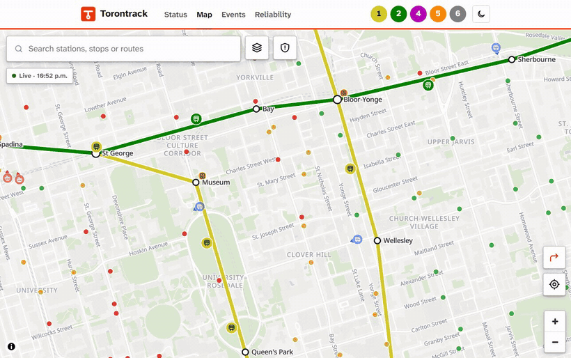
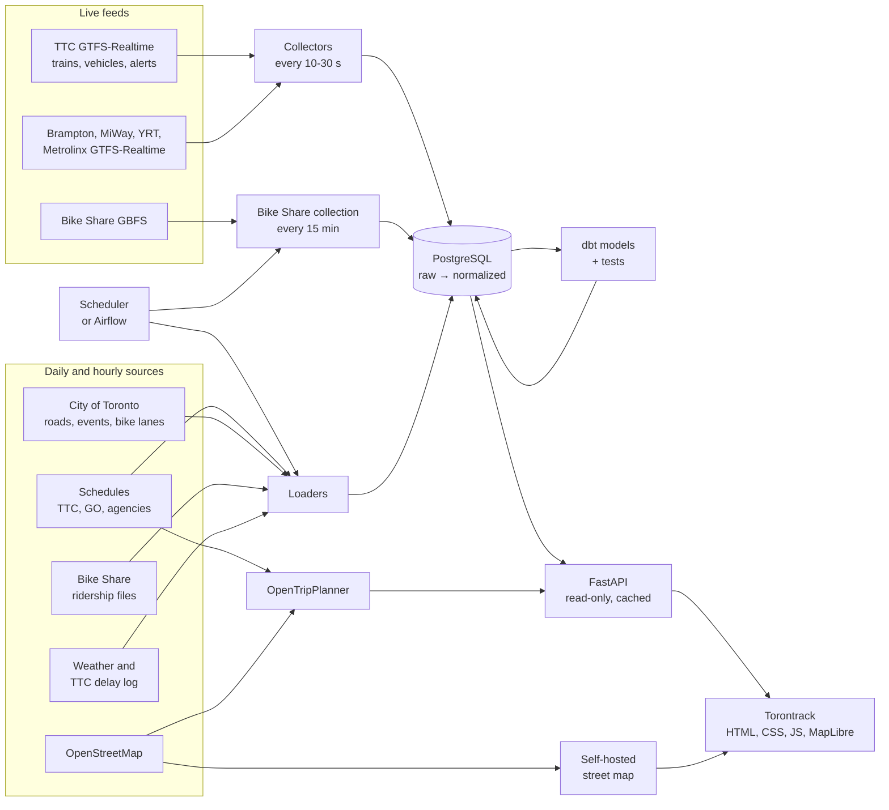

# Torontrack

A free, ad-free live map and reliability tracker for Toronto transit, built on the TTC's
GTFS-Realtime feeds, for riders who want to know where their train is and for anyone who
wants to know how reliable the service really is.

[](https://torontrack.skynetlab.duckdns.org)
[](https://github.com/MavenTheKeen/torontrack/actions/workflows/ci.yml)
[](LICENSE)



## Engineering highlights

- **Raw first, replayable.** Every feed response is stored before it is parsed.
  Validation and normalization are a separate step that can be re-run from the stored
  bytes, so a parser fix applies to history without refetching anything.
- **Validation you can see.** Each TTC snapshot goes through more than a dozen checks that
  reject or flag records, and every rejected or flagged record is stored with its reason. The pipeline page shows, per
  feed, how many distinct records were rejected or flagged in the last hour and why.
- **Health checks that look at the data.** A job that ran five minutes ago can still be
  loading day-old data or missing a third of its runs. Each check combines time since the
  last success, the share of expected runs completed, and the age of the newest record.
- **Tested against real responses.** About 370 tests run on recorded TTC, Bike Share and
  city responses, including PostgreSQL integration tests and a full dbt build, in GitHub
  Actions on every push.

The whole stack (collectors, PostgreSQL, dbt, the web app and a self-hosted
OpenTripPlanner covering Toronto, Brampton, Mississauga and York Region) runs on one
two-core server.

## Data quality findings

Problems found in the source data, and how each is handled:

- **TTC trip IDs do not identify trains.** The same train usually gets a different
  `trip_id` on consecutive polls, so trains are tracked by vehicle label
  ([train identity](docs/ttc.md#train-identity-and-arrivals)).
- **The subway feed has no positions or arrival events,** only predictions. A platform
  counts as passed only if the train was due there when it was last listed.
- **The TTC feed sometimes returns no trains at all** (about one snapshot in ten on the
  first day of collection). These snapshots are skipped rather than read as a service
  outage ([validation](docs/ttc.md#validation)).
- **Realtime bus trip IDs do not join reliably to the schedule.** Vehicles are matched to
  route patterns by geometry and heading instead: 96% of the fleet in about 0.3 seconds.
- **Alert types contradict their text.** A planned closure can be marked
  `REDUCED_SERVICE` while the text says there is no service, so each alert's status is
  derived from both and the mismatch is flagged.
- **Metrolinx's live feeds mix buses and trains, and its GPS fixes beat its delays.**
  Only trips on the loaded rail lines are kept. Placing a train by its reported delay
  alone is off by a median of 229 m from its GPS fix, so the fix is projected onto the
  track instead ([live trains](docs/regional.md#live-trains)).
- **Neighbouring agencies disagree on time zones.** MiWay's schedule says
  `America/New_York`, the others `America/Toronto`; OpenTripPlanner refuses to build
  until one zone is set for the whole graph ([trip planner](docs/planner.md)).
- **The 2025 Bike Share ridership files** repeat the start station's name as the end
  station's name in 6.8 million of 7.8 million trips, so all joins use station IDs
  ([ridership](docs/bikeshare.md#ridership-every-trip)).
- **TTC's official delay log** truncates station names to 22 characters and uses former
  names; 99.4% of incidents with a gap in service are still matched to a station
  ([delay log](docs/ttc.md#official-delay-log)).

More findings (road restriction JSON with unescaped backslashes, an events feed that
repeats each event once per date) are in the source documents.

## Decisions and tradeoffs

The TTC collector is a long-running process rather than a scheduled task, because it
polls every 10 seconds around the clock. Trains are tracked by vehicle label because trip
IDs change between polls. Map tiles are self-hosted, so the site needs no API key, sends
nothing about visitors to a third party and keeps a Content Security Policy with no
outside origins. Production runs a 60 MB scheduler instead of Airflow, which needed
1.1 GB on a server that also builds a 5 GB routing graph. The reasoning for these and
other choices is in [engineering decisions](docs/decisions.md).

## How it works



Browsers only ever talk to this server; only the collectors call the TTC, Metrolinx and
the city. The stack is Python 3.12, PostgreSQL 16, dbt, FastAPI, MapLibre GL JS,
OpenTripPlanner 2.10 and Docker Compose, with Airflow 3 DAGs for local use. The front end
is plain HTML, CSS and JavaScript with no build step.

What the site does, page by page, is in [features](docs/features.md).

## Quick start

You need Docker with Compose v2 and about 8 GB of RAM.

```powershell
Copy-Item .env.example .env
sh deploy/make_secrets.sh
docker compose --profile tools build
docker compose up -d --wait postgres
docker compose run --rm init-db
docker compose up -d ttc-collector web
```

The map is then at <http://localhost:8000> with live TTC data. Bike Share, the street
map, the trip planner and scheduled jobs each take one more command; see
[running it locally](docs/development.md), which also covers the tests.

## Documentation

- **Overview:** [features](docs/features.md), [engineering decisions](docs/decisions.md),
  [running it locally](docs/development.md), [deployment](docs/deploy.md)
- **Sources:** [TTC](docs/ttc.md), [neighbouring agencies](docs/agencies.md),
  [regional trains](docs/regional.md), [Bike Share](docs/bikeshare.md),
  [road restrictions](docs/roads.md), [events](docs/events.md), [weather](docs/weather.md)
- **Site:** [site and API](docs/site.md), [street map](docs/map.md),
  [trip planner](docs/planner.md), [trip guidance](docs/navigation.md)
- **Analysis:** [reliability](docs/reliability.md), [metric definitions](docs/metrics.md),
  [open data](docs/datasets.md)
- **Operations:** [Airflow](docs/airflow.md), [phone alerts](docs/alerts.md),
  [Windows setup](docs/setup-windows.md), [demo walkthrough](docs/demo.md)

## Licence and data sources

The code is under the [MIT License](LICENSE). The data is not: each source below keeps
its own licence and terms, and anything derived from it carries its attribution.

- Toronto Transit Commission GTFS and GTFS-Realtime open data. Predictions may be
  inaccurate. This project is not affiliated with the TTC.
- [Bike Share Toronto](https://bikesharetoronto.com/) / Toronto Parking Authority (live
  availability and ridership). Cycling network, road restrictions and events: City of
  Toronto. Contains information licensed under the
  [Open Government Licence – Toronto](https://www.toronto.ca/city-government/data-research-maps/open-data/open-data-licence/).
- Regional trains: data used in this product or service is provided with the permission
  of Metrolinx. This project is not affiliated with Metrolinx.
- Brampton Transit, MiWay and York Region Transit open data, each under its agency's
  terms ([neighbouring agencies](docs/agencies.md)).
- Weather: Environment and Climate Change Canada. Contains information licensed under the
  [Open Government Licence – Canada](https://open.canada.ca/en/open-government-licence-canada).
- Map data © [OpenStreetMap contributors](https://www.openstreetmap.org/copyright)
  (ODbL); basemap tiles by [Protomaps](https://protomaps.com/). Map rendering by
  [MapLibre GL JS](https://maplibre.org/) (BSD-3-Clause). Trip planning by
  [OpenTripPlanner](https://www.opentripplanner.org/) (LGPL).
- Concerts, games and shows: Ticketmaster Discovery API.
