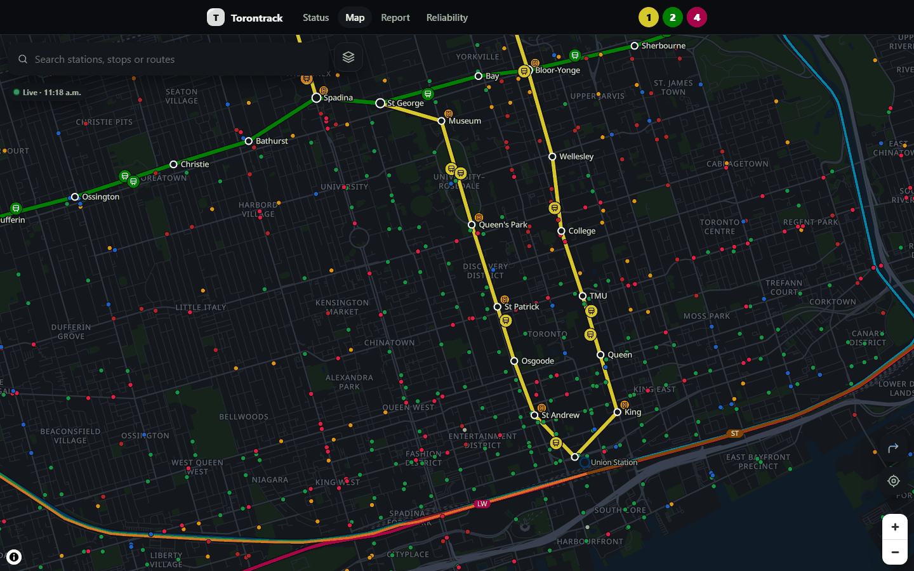
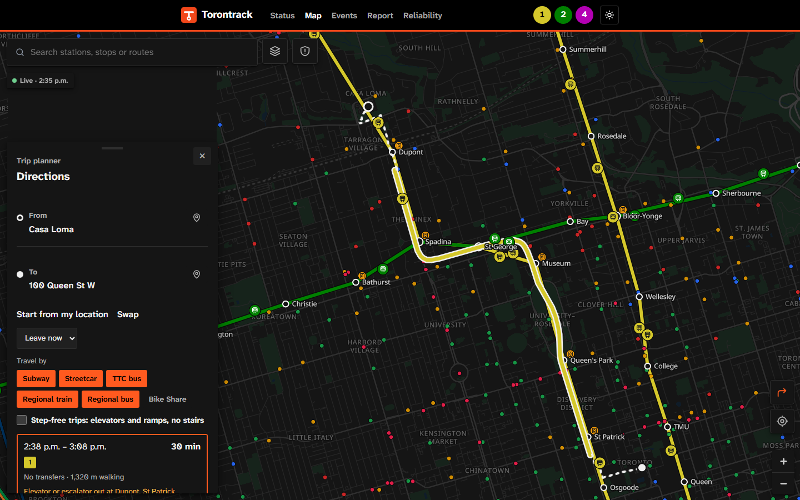
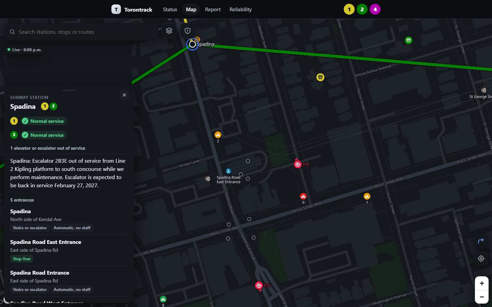
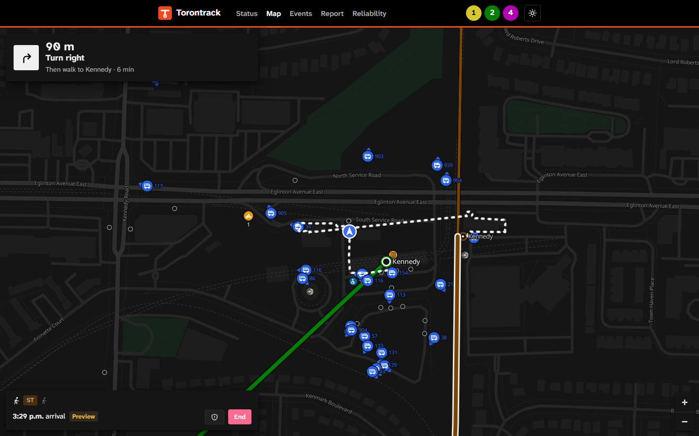
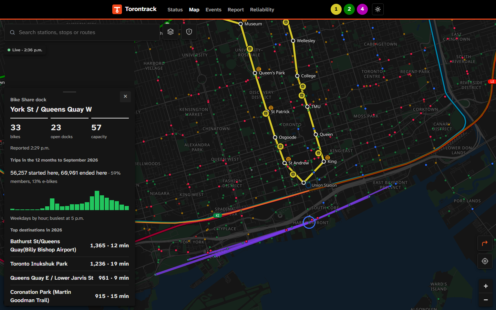
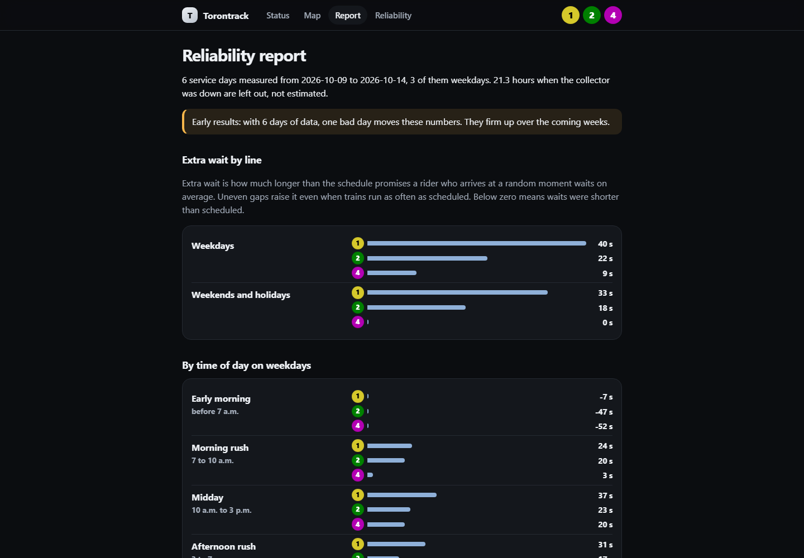
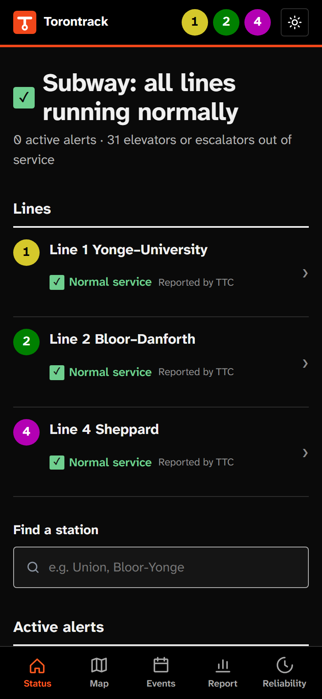
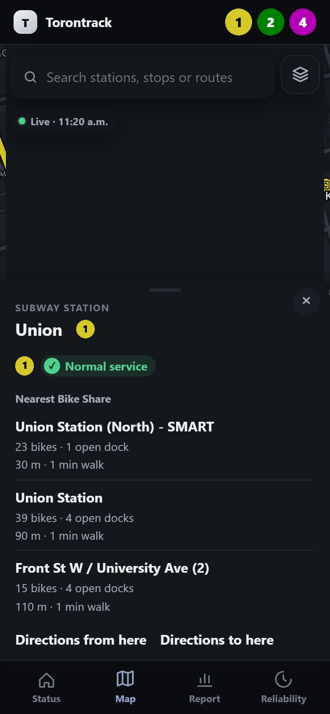
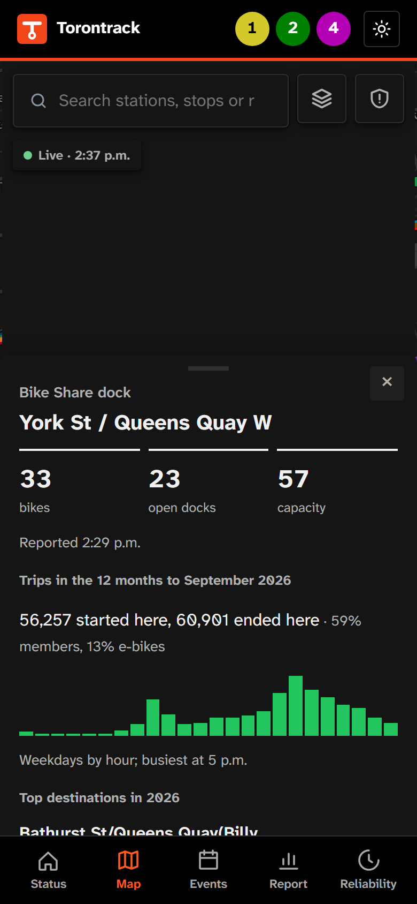
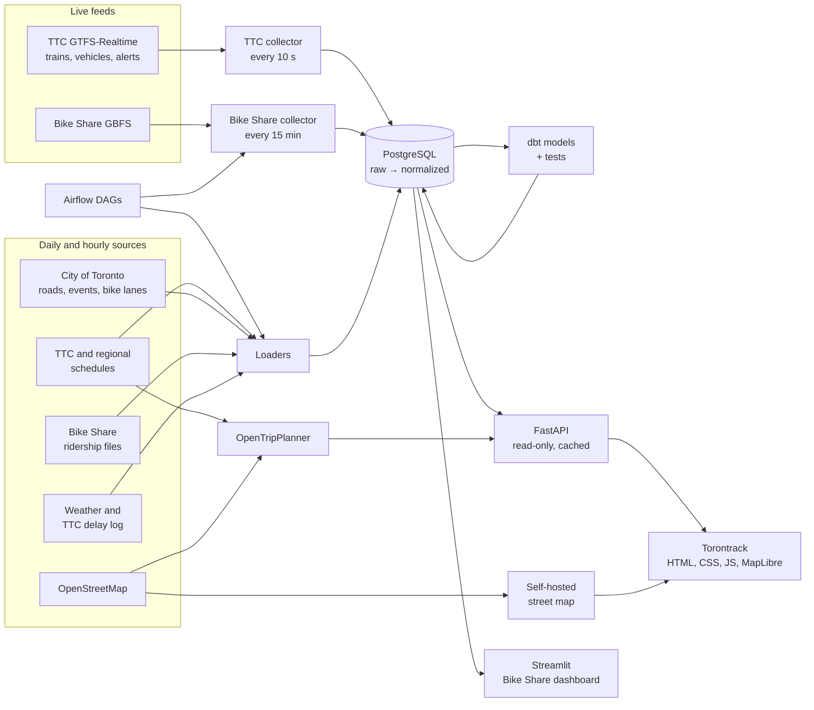

# Torontrack

Torontrack is a web map and data platform for Toronto transit. It collects live and
scheduled data from the TTC, Bike Share Toronto, Metrolinx and the City of Toronto,
validates and stores it in PostgreSQL, and serves a map, a trip planner and service
reliability reports.

[](https://github.com/MavenTheKeen/torontrack/actions/workflows/ci.yml)



Status: live at <https://torontrack.skynetlab.duckdns.org>, with live data collected
since 2026-10-09. The whole stack runs on one server behind an existing reverse proxy
([deployment](docs/deploy.md#behind-an-existing-proxy)).

## Features

### Map

The map shows subway lines with estimated train positions, all TTC buses and streetcars
with their routes and headings, and more than 9,000 surface stops with estimated
arrivals. Regional trains between Kitchener and Oshawa are positioned from the published
timetable. Bike Share docks show current bike and dock counts. Close up, every subway
station's entrances are shown with the side of the street each is on and whether it is
step-free; optional layers add public car parks with their entrances, and bike parking.
Between data refreshes, vehicles keep moving along their routes: subway trains toward
their predicted arrival, buses and streetcars at the route's usual pace for that hour.
The basemap is built from OpenStreetMap and served by the application, so no third-party
tile service is used.

A safety panel lists what to do in an emergency, the TTC's on-board and platform safety
features, and support lines. It is reference only and does not contact anyone.

Location is optional. When enabled, the map shows the nearest stations, stops and docks;
the position is used only in the browser and is not sent to the server.

### Trip planning

Directions combine subway, streetcar, bus, regional train, Bike Share and walking. Routing
is provided by a self-hosted OpenTripPlanner instance built from the TTC and regional
schedules, OpenStreetMap and Bike Share's live station feed. Plans use published
timetables, not live predictions. The start and end can be typed as an address, a place,
an intersection, a station or a stop, from a search index built from OpenStreetMap and
served by the application, so planning never needs the visitor's location. Each way of
travelling can be switched off, and the choice is remembered on the device.
Each subway ride names the station entrance to use and the exit to take. Step-free trips
use only accessible stations and stops, and rides to or from a station with an elevator or
escalator out of service carry the TTC's alert.

A planned trip can be guided step by step: walking turns, where to board, a live arrival
estimate while waiting for a TTC bus or streetcar, the stops left on each ride, and arrival.
The site can be installed to a phone's home screen. See [trip guidance](docs/navigation.md).

### Bike Share

Each dock shows live availability and a summary of its trips over the last twelve
months: departures by hour and its most common destinations, drawn on the map. The
summaries cover 21.5 million trips since January 2024. The City of Toronto cycling
network is available as a map layer.

### Events

The Events page shows what is on over the next two weeks: the city's festivals and
community events, and concerts, games and shows from Ticketmaster. A strip of days leads
to each day's events in time order, with the nearest station and walking time, a heads-up
when an arena or stadium event will crowd a station, and a button that plans the trip
there. See [events](docs/events.md).

### Road restrictions

City of Toronto construction zones and road closures are shown with the bus and
streetcar routes they affect. Station panels list the city's events within walking
distance.

### Service status

The status page lists current TTC disruptions, a diagram of each subway line with
estimated train positions, and arrivals at every station. Where trains stop appearing in
the feed for longer than the scheduled interval, the line is marked as a possible delay
and labelled as not confirmed by the TTC.

### Reliability reporting

The report measures excess wait time, the average time riders wait beyond what the
schedule implies, by line, time of day, platform and weather. It also reports bus
bunching and compares bus service on days with and without road closures. TTC's
official delay log is loaded for comparison.

### Open data

Observed train gaps and Bike Share dock readings are published daily as Parquet and CSV
files, with checksums and column descriptions.

| Trip planner | Station entrances |
| --- | --- |
|  |  |
| **Trip guidance** | **Where Bike Share trips go** |
|  |  |

| Reliability report |
| --- |
|  |

| Service status | Station panel | Bike Share dock |
| --- | --- | --- |
|  |  |  |

## How it works



Collectors store raw responses first, then validate and normalize them in a separate
step that can be replayed from storage. Every run, rejected record and data-quality
check is recorded, which feeds a pipeline status page and phone alerts. Browsers never
call TTC, Metrolinx or the city; only the collectors do.

The stack is Python 3.12, PostgreSQL 16, dbt, Airflow 3, FastAPI, MapLibre GL JS,
Protomaps, OpenTripPlanner 2.10, Streamlit and Docker Compose. The front end is plain
HTML, CSS and JavaScript with no build step.

## Data quality findings

Problems found in the source data, and how each is handled:

- TTC `trip_id` values do not identify trains: the same train receives a new ID between
  polls, so trains are tracked by vehicle label.
  See [train identity](docs/ttc.md#train-identity-and-arrivals).
- The subway feed provides predictions but no arrival events or positions. A platform is
  treated as passed only if the train was due there when it was last listed.
- The TTC feed periodically returns snapshots with no trains (about one in ten on the
  first day of collection). These snapshots are discarded rather than treated as an
  absence of service. See [validation](docs/ttc.md#validation).
- Realtime vehicle trip IDs do not join reliably to the static schedule. Vehicles are
  matched to route patterns by geometry and heading instead, with 96% of the fleet
  matched in about 0.3 seconds.
- The road restrictions feed is not always valid JSON; unescaped backslashes are repaired
  during loading. See [road restrictions](docs/roads.md).
- In the 2025 Bike Share ridership files, 6.8 million of 7.8 million trips repeat the
  start station name as the end station name. Station IDs are used for all joins. See
  [ridership](docs/bikeshare.md#ridership-every-trip).
- The events feed is about 225 MB because each event is repeated once per date. It is
  parsed as a stream and duplicate records are merged (308 events in October 2026). See
  [events](docs/events.md).
- Station names in TTC's delay log are truncated to 22 characters and use former names
  and abbreviations; 99.4% of incidents involving a gap in service are matched to a
  station. See [official delay log](docs/ttc.md#official-delay-log).

## Design notes

- Raw Bike Share responses are stored once per distinct body, keyed by SHA-256. On the
  first day of collection this reduced storage from 36.4 MB to 8.0 MB without losing any
  payload. Ridership is stored as summaries, about 330 MB for 21.5 million trips. See
  [storage layout](docs/bikeshare.md#storage-layout).
- Headway measurements exclude terminal stations, where vehicles queue, and exclude
  periods when the collector was not running. Results based on a short collection period
  are labelled as preliminary.
- The routing graph is rebuilt only when its source data changes, and the routing server
  is stopped during the rebuild. Peak memory is that of the build, about 3.7 GB. See
  [trip planner](docs/planner.md).
- The web application uses a read-only database role, a 15-second response cache,
  per-client rate limits and a strict Content Security Policy.
- Schema changes are numbered SQL migrations, each applied once in a transaction under
  an advisory lock.
- Each data source's required attribution is included with the data derived from it.
  Regional data is used under Metrolinx's terms, which require an attribution statement,
  prohibit use of Metrolinx marks and prohibit redistribution of the realtime feed.

## Quick start

Requirements: Docker with Compose v2 (on Windows, Docker Desktop with WSL2; see
[Windows setup](docs/setup-windows.md)) and about 6–8 GB of RAM, plus 4 GB while the trip
planner rebuilds its graph. Passwords and keys are files in `secrets/`, created by
`deploy/make_secrets.sh` (run in Git Bash on Windows) and ignored by Git
([secrets](docs/deploy.md#secrets)).

```powershell
Copy-Item .env.example .env
sh deploy/make_secrets.sh
docker compose --profile tools build
docker compose up -d --wait postgres
docker compose run --rm init-db
docker compose up -d ttc-collector web alerts dashboard
docker compose run --rm collector collect
docker compose run --rm dbt
docker compose run --rm ttc-collector regional-refresh
docker compose run --rm ttc-collector bikeshare-trips-refresh
docker compose run --rm ttc-collector events-refresh
docker compose --profile tools run --rm map-tiles
docker compose --profile planner up -d
```

The site is served at <http://localhost:8000> and the Bike Share dashboard at
<http://localhost:8501>.

The TTC collector loads the static schedule on first start and then polls subway
predictions and vehicle positions every 10 seconds and alerts every 30.
`bikeshare-trips-refresh` loads all Bike Share trips since 2024 (three files of about
200 MB). `map-tiles` builds the basemap, the bike lane layer and the station
entrance, parking and bike parking layers in about two minutes; see
[street map](docs/map.md). The `planner` profile downloads its source data and builds
and serves the routing graph in about four minutes; see [trip planner](docs/planner.md).

Airflow schedules all non-continuous work: Bike Share collection and dbt builds,
schedule refreshes, ridership, roads, events, weather, the delay log, open-data exports
and planner downloads.

```powershell
docker compose --profile airflow build airflow
docker compose --profile airflow up -d airflow
foreach ($dag in "toronto_bikeshare_reliability", "ttc_static_gtfs", "open_data_export",
    "ttc_official_delays", "weather_hourly", "regional_schedule", "road_restrictions",
    "bikeshare_trips", "city_events", "ticketed_events", "planner_data") {
  docker compose exec airflow airflow dags unpause $dag
}
```

Airflow's UI is at <http://localhost:8080>; all ports bind to localhost. See
[Airflow operation](docs/airflow.md). To stop everything without deleting collected history, run
`docker compose --profile airflow --profile planner down`. Adding `--volumes` deletes
all collected data.

## Repository layout

| Path | Contents |
| --- | --- |
| `src/transit/ttc/` | TTC realtime and schedule collection, vehicle matching, stop passages, retention |
| `src/transit/bikeshare/` | Bike Share live collection, ridership summaries, dashboard queries |
| `src/transit/web/` | FastAPI app and the site (plain HTML/CSS/JS, no build step) |
| `src/transit/` | CLI (`transit`), regional trains, roads, events, bike lanes, weather, trip planner inputs, street map, open-data export |
| `src/transit/migrations/` | Numbered schema migrations |
| `dbt/` | Staging and analytics models and tests |
| `airflow/` | DAGs and their tests |
| `dashboard/` | Streamlit Bike Share dashboard |
| `docker/`, `deploy/` | Trip planner runner, production Compose, Caddy and backups |
| `tests/` | Unit and PostgreSQL integration tests on recorded real responses |

## Tests

Tests use recorded real responses and controlled mutations, never a live API. GitHub
Actions runs the PostgreSQL and dbt suite, an Airflow DAG import test in the Airflow
image, and container startup checks.

Integration tests **clear project tables** in a database whose name must end in
`_test`; they never touch the live `transit` database. With Python 3.12, uv 0.9.5 and
Compose PostgreSQL running:

```powershell
uv sync --locked
uv sync --project dbt --locked
docker compose exec postgres createdb -U transit transit_test
$env:TEST_DATABASE_URL="postgresql://transit:$(Get-Content secrets/postgres_password)@127.0.0.1:5432/transit_test"
$env:DBT_EXECUTABLE="$PWD/dbt/.venv/Scripts/dbt.exe"
uv run --locked pytest -q
uv run --locked ruff check src tests dashboard scripts airflow
```

Use `127.0.0.1`, not `localhost`. On Windows, `localhost` tries IPv6 first, and
PostgreSQL is published on IPv4 only. On Linux and macOS, use `export NAME=value` and
`DBT_EXECUTABLE="$PWD/dbt/.venv/bin/dbt"`. Without `TEST_DATABASE_URL`, the PostgreSQL
tests are skipped; to run offline only, use
`uv run --locked pytest -m 'not integration' -q`.

Native commands read `DATABASE_URL` and, optionally, `DATABASE_PASSWORD_FILE`; the app
does not load `.env` by itself:

```powershell
$env:DATABASE_URL='postgresql://transit@127.0.0.1:5432/transit'
$env:DATABASE_PASSWORD_FILE='secrets/postgres_password'
uv run --locked transit --help
uv run --locked uvicorn transit.web.app:app --host 127.0.0.1 --port 8000
```

## Documentation

- **Feeds:** [TTC](docs/ttc.md), [Bike Share](docs/bikeshare.md) (live and
  [ridership](docs/bikeshare.md#ridership-every-trip)), [regional trains](docs/regional.md),
  [road restrictions](docs/roads.md), [events](docs/events.md), [weather](docs/weather.md)
- **Site:** [site and API](docs/site.md), [street map](docs/map.md),
  [trip planner](docs/planner.md), [trip guidance](docs/navigation.md)
- **Analysis:** [reliability analytics](docs/reliability.md),
  [metric definitions](docs/metrics.md), [open data](docs/datasets.md)
- **Operations:** [deployment](docs/deploy.md), [collector server](docs/collector.md),
  [Airflow](docs/airflow.md),
  [phone alerts](docs/alerts.md), [Windows setup](docs/setup-windows.md)
- **Background:** [engineering decisions](docs/decisions.md),
  [demo walkthrough](docs/demo.md), [source verification](docs/source.md)

## Data sources and attribution

- Data: Toronto Transit Commission (GTFS and GTFS-Realtime open data). Predictions may be
  inaccurate. This project is not affiliated with the TTC.
- [Bike Share Toronto](https://bikesharetoronto.com/) / Toronto Parking Authority (live
  availability and ridership data). Cycling network, road restrictions and events: City
  of Toronto. Contains information licensed under the
  [Open Government Licence – Toronto](https://www.toronto.ca/city-government/data-research-maps/open-data/open-data-licence/).
- Regional trains: data used in this product or service is provided with the permission
  of Metrolinx. This project is not affiliated with Metrolinx.
- Weather: Environment and Climate Change Canada. Contains information licensed under the
  [Open Government Licence – Canada](https://open.canada.ca/en/open-government-licence-canada).
- Map data © [OpenStreetMap contributors](https://www.openstreetmap.org/copyright)
  (ODbL); basemap tiles by [Protomaps](https://protomaps.com/). Map rendering by
  [MapLibre GL JS](https://maplibre.org/) (BSD-3-Clause). Trip planning by
  [OpenTripPlanner](https://www.opentripplanner.org/) (LGPL).

## Troubleshooting

- **Docker unavailable:** start Docker Desktop and check `docker info`; a Compose CLI
  alone is not an engine.
- **Database unavailable:** `docker compose ps` and `docker compose logs postgres`.
  Changing `secrets/postgres_password` does not change an existing PostgreSQL volume's
  password.
- **No trains on the site:** `docker compose logs --tail 20 ttc-collector`; `/health`
  reports `degraded` when predictions are more than 2 minutes old.
- **No Directions button:** the trip planner is not running or is still building;
  `docker compose --profile planner logs planner`.
- **Port collision:** set `POSTGRES_PORT`, `WEB_PORT`, `DASHBOARD_PORT` or
  `AIRFLOW_PORT` in `.env`.

Source-specific troubleshooting is in the [TTC](docs/ttc.md) and
[Bike Share](docs/bikeshare.md) documentation.
