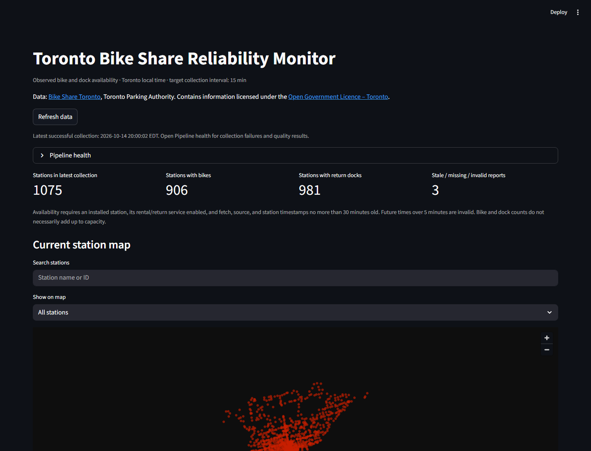

# Bike Share collection and dashboard

The Bike Share pipeline collects real Toronto Bike Share availability from the official
GBFS 3.0 API every 15 minutes, keeps the source JSON in PostgreSQL, and shows current
availability, observed empty/full rates, hourly patterns and pipeline health in a
Streamlit dashboard. The public site's station pages and map read the same data.

**History starts when collection starts.** This is a sampled monitor, not a trip
counter or an archive of past station availability. Fixtures are never served as live
data. Source: [Bike Share Toronto](https://bikesharetoronto.com/) / Toronto Parking
Authority. Contains information licensed under the
[Open Government Licence – Toronto](https://www.toronto.ca/city-government/data-research-maps/open-data/open-data-licence/).
See [source verification and licensing nuances](source.md).



## Data flow

1. **Raw**: each GBFS response (discovery, station information, station status) is
   stored before any parsing, with the hash of the payload as received.
2. **Validate and normalize**: in a separate transaction, payloads are parsed and
   validated into the normalized tables below. A malformed or empty feed fails the
   collection rather than storing an empty dataset.
3. **Transform**: dbt builds staging and analytics views (hourly station metrics,
   empty/full rates) with tests; results are recorded in `ops.transformation_runs`.
4. **Ops**: every attempt is a row in `ops.ingestion_runs` / `ops.ingestion_attempts`,
   and data-quality checks are recorded alongside.

## Storage layout

Most of each collection repeats the previous one, so repeated content is stored once
(migration `0001_bikeshare_compact_storage`). Nothing is discarded.

| Table | One row per | Holds |
| --- | --- | --- |
| `raw.feed_payloads` | fetch | Envelope (`last_updated`, `ttl`, `version`), fetch times, hash of the full payload, `body_hash` |
| `raw.payload_bodies` | distinct `data` content | The payload's `data` member, keyed by the SHA-256 of its canonical jsonb text |
| `normalized.collections` | collection | Collection time, status fetch and publication times, raw lineage |
| `normalized.station_versions` | distinct station name/location/capacity | Station metadata |
| `normalized.observations` | reported station per collection | Counts, flags, report time, station version |
| `normalized.unobserved_stations` | station listed without a status report | Kept so coverage stays exact |

Two views put it back together: `raw.feed_payloads_full` returns every payload exactly
as received (`payload_hash` still verifies it), and `normalized.station_observations`
returns one row per station listed in each collection's metadata, with its status when
reported (`observed`). dbt, the dashboard and the site read the view.

Measured on the first day's data (34 collections): 36.4 MB before, 8.0 MB after.
Observation rows went from 158 to 64 bytes. Station information bodies are shared by
most fetches; they change only when a field such as `is_valet_station` toggles for event
valet service (6 distinct bodies in 35 fetches). Status bodies are new every time.

## Collect, retry and replay

With the stack from [running it locally](development.md#full-setup) running:

```powershell
docker compose run --rm collector collect --collection-id first-local-collection
docker compose run --rm dbt
docker compose up -d dashboard
```

Open **<http://localhost:8501>**. The dashboard never fetches the live API itself;
Refresh reads committed database data. If no collection exists, it shows an empty
state. It marks stale data explicitly and excludes it from current availability.

Check retry and replay using the same collection ID:

```powershell
docker compose run --rm collector collect --collection-id first-local-collection
docker compose run --rm collector replay --collection-id first-local-collection
docker compose run --rm dbt
```

The retry returns `already_succeeded`; replay reconstructs that collection from stored
JSON without HTTP. A genuinely later collection should use a new ID:

```powershell
docker compose run --rm collector collect
```

The generated UUID is printed. Identical later counts are kept as a new observation.
The source publication time, station report time, and collection time are separate
columns. Dashboard timestamps use America/Toronto.

An explicit live API parse check (no database writes):

```powershell
docker compose run --rm collector smoke
```

Scheduled collection runs through Airflow; see [Airflow operation](airflow.md).

## Metrics and limitations

- Empty percentage uses rental-eligible observed snapshots; full percentage uses
  return-eligible snapshots. Missing, stale, inactive, or disabled service readings
  are excluded. Zero denominator means unknown, not 0%.
- Rankings show their denominators. Station observation coverage compares status rows
  with metadata rows; system collection coverage counts occupied complete UTC 15-minute
  slots across the selected period, including time before collection began.
- Available bikes plus available docks need not equal capacity. Optional disabled
  counts and capacity remain unknown when omitted.
- These percentages describe samples, not exact minutes, trip counts, or guaranteed
  availability on arrival. A handful of snapshots is insufficient for strong rankings.
- Views favor clarity over long-history performance. There is no automatic retention
  for Bike Share data.

Read [metric definitions](metrics.md) and the [demo walkthrough](demo.md).

## Ridership: every trip

The live feed shows how many bikes are at each dock, not where people ride. For that,
`transit bikeshare-trips-refresh` loads the city's ridership open data ("Bike Share
Toronto Ridership Data", Toronto Parking Authority, one zip per year, updated monthly a
few weeks after each month ends) from 2024 on. About 7 million trips (1 GB of CSV) a year
is too much to keep row by row on a small server, so each yearly file is streamed from a
temporary download into summaries, and the year's rows are replaced in one transaction:

| Table | Grain | Rows a year |
| --- | --- | --- |
| `normalized.bikeshare_trip_station_days` | Dock and day: departures, arrivals, members, e-bikes, round trips | ~290,000 |
| `normalized.bikeshare_trip_station_hours` | Dock, month, weekday or weekend, hour: departures and arrivals | ~400,000 |
| `normalized.bikeshare_trip_pairs` | Start dock, end dock and year: trips, members, e-bikes, total time | ~370,000 |
| `normalized.bikeshare_trip_stations` | Newest start-record name of each dock | ~1,100 |
| `normalized.bikeshare_trip_files` | Each year loaded: trips, date range, rows skipped and why | 1 |

The `bikeshare_trips` Airflow DAG checks the catalogue daily; a year is downloaded only
when its catalogue entry changed, and reloaded only when the file's SHA-256 changed.
Parsing a year takes about 2 minutes (dates are parsed once each and cached; `strptime` on
14 million timestamps was the slow part).

What the files contain:

- **End dock names copied from the start.** In the 2025 files for January to November,
  `End_Station_Name` repeats the start dock's name even when `End_Station_Id` is a
  different dock: 6.8 million of 7.8 million 2025 trips. Dock IDs are right, so the loader
  uses IDs only, takes names from start records (and the live feed for the map), and
  records the count per file as `end_name_copied`.
- End dock IDs are floats in some files (`7037.0`).
- Trips under 60 seconds are false starts and are dropped (about 20,000 a year). A trip
  with no end dock (about 4,000 to 13,000 a year) counts as a departure only. Trips over
  3 hours count but are left out of the typical trip time.
- Times are Toronto local time without an offset and are used as written.

The map's dock panel shows the dock's trips over the 12 months the data reaches, its
weekday trips by hour, and its top destinations, drawn as lines from the dock. The report
adds trips by month, the busiest docks and the most popular trips.

## Troubleshooting

- **No analytics yet:** run `docker compose run --rm dbt`; inspect the recorded build
  result in Pipeline health. After schema changes, rerun `init-db`.
- **Collection failed:** inspect `ops.ingestion_attempts` and Airflow/collector logs.
  Stored raw data can be replayed after a parser fix.
- **Stale data:** confirm collection is running and inspect all three clocks. A
  successful API request can still contain stale station reports.
