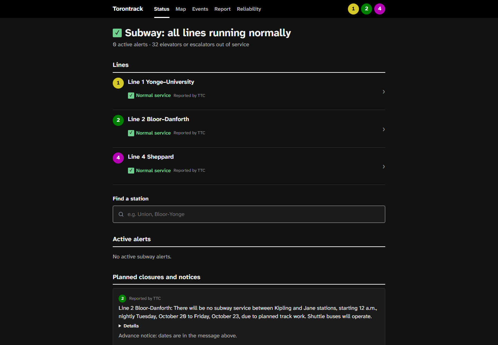
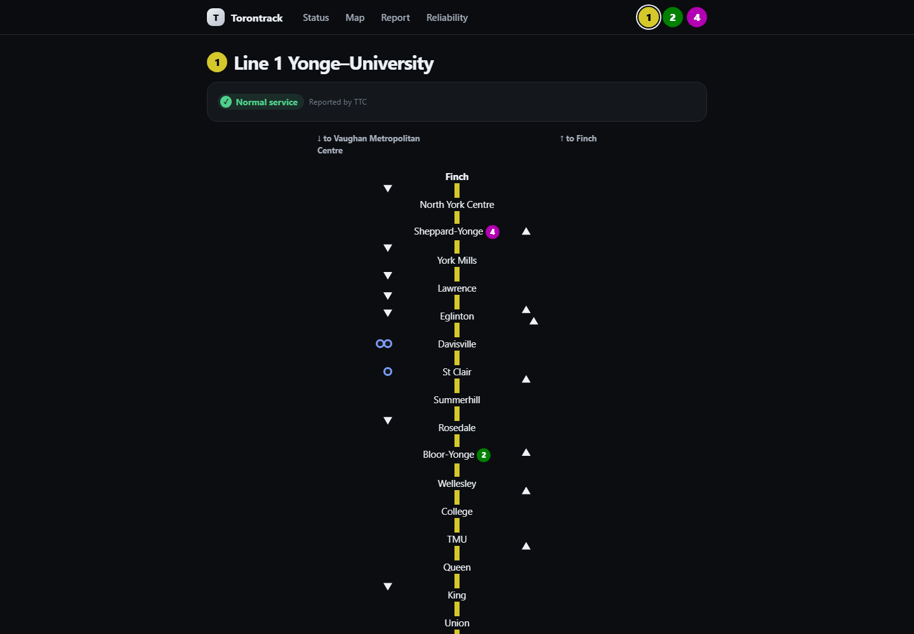
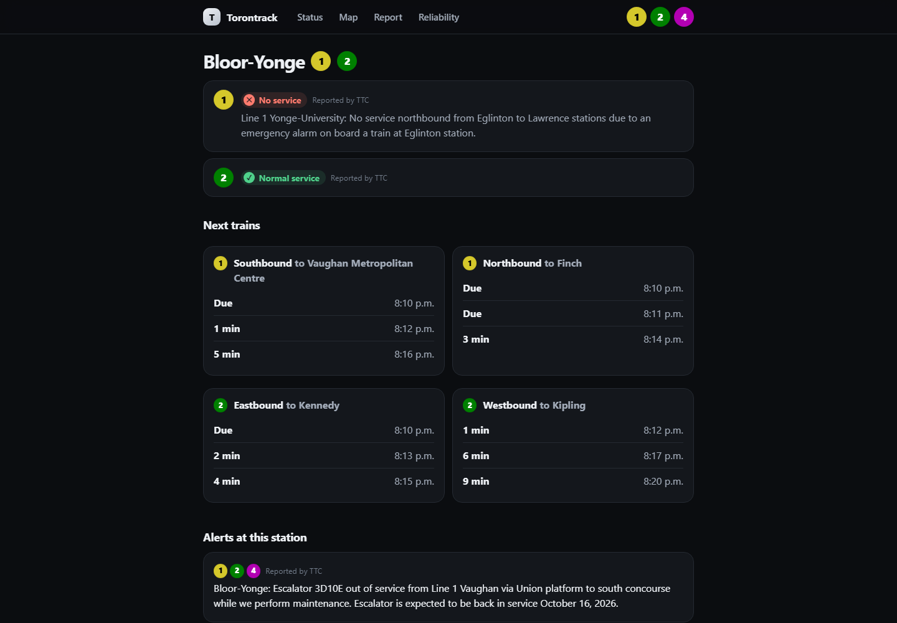
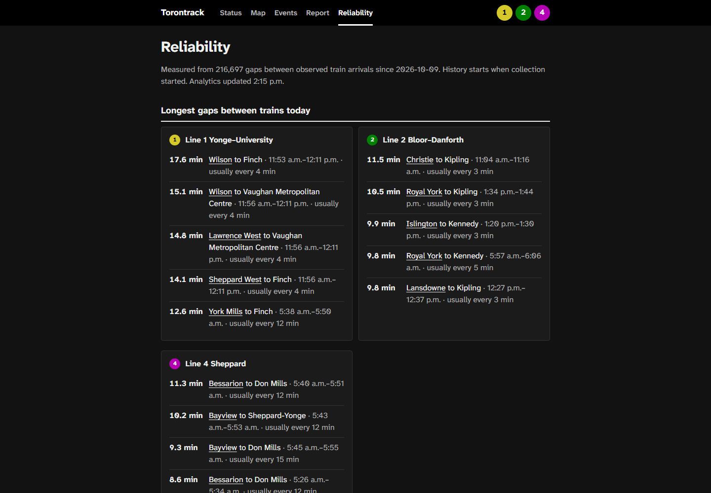

# Public site and API

`web` serves **Torontrack**: a read-only JSON API and a single mobile-first page. It reads only from
PostgreSQL; browsers never call the TTC or Bike Share APIs.

```powershell
docker compose up -d web
```

Open <http://localhost:8000>. Pages use hash routes: `#/` (service status), `#/line/1`
(line view), `#/station/bloor-yonge` (station), `#/map` (live street map; `#/map/bloor-yonge`
opens it on a station), `#/events` (what's on, `#/events/2026-10-17` for one day), `#/stop/15647` (bus or streetcar stop), `#/reliability` (reliability), `#/report` (reliability report), `#/pipeline` (pipeline status).

| Home | Line | Station | Map | Reliability |
| --- | --- | --- | --- | --- |
|  |  |  |  |  |

Screenshots were captured from real data on 2026-10-09 at about noon Toronto time,
about 2 h 30 min after collection started.

## Endpoints

| Path | Returns |
| --- | --- |
| `/api/status` | One status row per line: `normal`, `delays`, `reduced_service`, `modified_service`, `no_service`, or `unknown` when alerts are stale. `source` is `reported` (from TTC alerts). `detected` holds our own possible-delay inference, only when TTC reports nothing. |
| `/api/alerts` | Active service alerts, upcoming planned closures and advance notices, and active elevator/escalator outages. |
| `/api/lines` | Lines with colours, directions and status, plus every station for search. |
| `/api/lines/{id}` | Stations in order, estimated train positions, gaps between consecutive trains, and the scheduled headway now. |
| `/api/stations/{key}` | Next arrivals per platform, alerts naming the station's platforms, line status, and the nearest Bike Share docks. |
| `/api/map` | Each line's path through its stations, station coordinates with any elevator or escalator outages (matched through the station's platforms; see [trip planner](planner.md#step-free-trips)), each station's entrances and nearby bike parking ([street map](map.md#station-entrances-parking-and-bike-parking)), and every Bike Share dock from the latest collection with bikes, open docks and capacity. |
| `/api/surface` | Every bus and streetcar route and stop with the routes serving each stop; changes only with a new schedule. |
| `/api/vehicles` | Every bus and streetcar in service: route, mode, position, heading, destination when matched to its route, and occupancy. |
| `/api/stops/{stop_id}` | A bus or streetcar stop with the routes and destinations serving it and the next vehicles' estimated arrivals (see [buses and streetcars](ttc.md#buses-and-streetcars)). |
| `/api/routes/{route_id}` | A surface route with the paths of its main patterns, for drawing it on the map. |
| `/api/docks/{id}/trips` | A Bike Share dock's trips over the last 12 months of published ridership: totals, weekday hours and top destinations. |
| `/api/events` | City of Toronto festivals and events from today to 7 days ahead; see [events](events.md). |
| `/api/agenda` | The Events page: city events and Ticketmaster concerts, games and shows for the next 14 days, each with its category, major-venue flag and nearest station; see [events](events.md#the-events-page). |
| `/api/roads` | Construction zones and road closures in effect today, with geometry, hours and impact; see [road restrictions](roads.md). |
| `/api/regional`, `/api/regional/trains`, `/api/regional/stations/{id}` | Regional train lines, timetable positions and scheduled departures; see [regional trains](regional.md). |
| `/api/trains` | Every line's estimated train positions for the map: each train's position is a fractional index into the line's station list, as on the line diagrams. |
| `/api/report` | The reliability report over every measured day: excess wait time, regular and long-gap shares by line and day type, by time of day on weekdays, by weather, by day, and the ten platforms with the most extra wait (at least 150 measured gaps). `available: false` until the first build. |
| `/api/reliability` | Longest gaps today, regular-headway share by hour (today and 7 days), and elevator/escalator outages, from the dbt models. `available: false` until the first build. |
| `/api/pipeline` | Health of each TTC feed, Bike Share collection and the dbt build (`ok`, `delayed` or `failing` by time since the last success), today's feed dropout rate, the latest data-quality checks and data volume. Shown at `#/pipeline`. |
| `/api/datasets` | The open-data index: datasets, column descriptions, and every published file with rows and checksums. `available: false` before the first export. Files are served under `/data/`. See [open data](datasets.md). |
| `/api/plan` | Trip plans between two points by TTC, regional train and bus, Bike Share and walking, from published timetables, using only the chosen modes. `503` while the optional planner is not running. See [trip planner](planner.md). |
| `/api/places` | Addresses, named places and intersections matching typed text, for the planner's From and To and the map search; self-hosted from OpenStreetMap. See [trip planner](planner.md#typing-a-start-or-end). |
| `/api/plan/status` | Whether the trip planner is running, and the area it covers. |
| `/health` | `ok`, `degraded` (predictions older than 2 minutes), `no_data` (no schedule loaded), or HTTP 503 if PostgreSQL is unreachable. |

Every response includes `generated_at` and the attribution. Freshness objects
(`as_of`, `stale`) accompany predictions, alerts and Bike Share data.

## How positions, gaps and status are derived

Reliability metrics and detected delays are defined in [reliability analytics](reliability.md).

- **Train position.** The subway feed has no vehicle positions. TTC often predicts a
  train's first listed platform at the current time even while it is between stations,
  so the next platform is the first predicted more than 20 seconds ahead. If that
  arrival is further away than the scheduled run from the previous platform, the train
  has not left the previous platform; otherwise it is placed between the two in
  proportion to the remaining time. Scheduled run times are medians from static GTFS.
- **Gaps.** Consecutive moving trains in a direction are separated by the scheduled
  running time between their positions. A gap is marked long when it exceeds both twice
  the scheduled headway and the headway plus 5 minutes. The headway counts trips in the
  next/previous 30 minutes at a mid-line platform on today's service calendar. Trains
  waiting at their first platform are excluded.
- **Status.** The most severe active TTC service alert on the line. Advance notices
  ("There will be no subway service ... nightly") are listed under planned closures and
  do not change today's status, because TTC sets their active period to the whole notice
  window rather than the closure hours.

## Map

The map is drawn with [MapLibre GL JS](https://maplibre.org/) on the site's own street
basemap ([street map](map.md)), so it still makes no third-party requests; MapLibre, the
tile reader and the label fonts are served from `/static/vendor` and load only when the
map opens. On top of the streets:

- **Subway lines and stations**, with a ring on stations that have an elevator or
  escalator out of service. Lines are drawn straight between stations.
- **Trains** at their estimated positions, each direction a little to its own side of the
  line. Data refreshes every 10 seconds, and between refreshes trains, buses and
  streetcars move along their routes by estimate ([moving vehicles](map.md#moving-vehicles)).
  With reduced motion, positions update every 5 seconds without gliding.
- **Buses and streetcars** (blue and crimson) as heading arrows with their route number
  when zoomed in, and every bus and streetcar stop from street
  level. Tapping a vehicle shows its route and destination; "Show route" draws the route's
  main patterns and fades other vehicles. Tapping a stop shows its routes and the next
  vehicles' estimated arrivals ([how they are estimated](ttc.md#buses-and-streetcars));
  the same estimates are on the stop's own page.
- **Regional trains** on their own line colours, each marker labelled with its line code,
  placed by timetable (not live; [regional trains](regional.md)). The map zooms out far
  enough to show the whole network. Tapping a station lists its scheduled departures.
- **Road restrictions** from street level: construction solid amber, closures dashed
  orange, faded outside their working hours ([road restrictions](roads.md)).
- **Events** this week from the city's calendar, today's solid, and a station panel's
  "Events nearby today" ([events](events.md)).
- **Station entrances** from zoom 15, step-free ones in their own colour, with their
  names from zoom 16.5. Tapping one shows its street side and whether it is step-free,
  automatic or exit only.
- **Parking and bike parking** (off until switched on): public car parks with their mapped
  entrances and the side of the street each is on, and bicycle racks, shelters and lockers
  ([street map](map.md#station-entrances-parking-and-bike-parking)).
- **Bike Share docks** (from street level), coloured by bikes or open docks. A dock that is not installed, or
  whose own report is more than 30 minutes old, is grey and makes no availability claim,
  the same rule the dashboard uses. Docks refresh every 2 minutes.

Tapping a station, dock or train opens a panel: line status, outages, entrances, nearby
bike parking and the nearest docks for a station; counts for a dock; next stop for a train.
A station's line status reflects only alerts that cover it: an alert naming other stations
(a closure from Eglinton to Lawrence, seen from Union) shows as "Running here" with the
alert beneath it as elsewhere on the line, and an alert naming no stations applies to the
whole line. The locate button asks for the
browser's location, shows it with its accuracy, and lists the closest stations and docks
with walking distance (straight line at 80 m a minute). The location is used only in the
page and never sent anywhere; it needs HTTPS (or localhost).

The layers button beside the search opens a panel with a switch for each layer (subway,
regional trains, buses and streetcars, Bike Share, elevator outages, station entrances,
roadwork, events, bike lanes, bike parking and parking) and a legend. Roadwork, events, bike
lanes, bike parking and parking start off. Markers are icon badges
from `static/icons.js`, the same icons the legend shows, and each layer appears from the zoom
level where it stays readable: buses and streetcars are small dots across the city and icons
with a heading pointer from zoom 14; docks are coloured dots from zoom 13 and icons with counts
from zoom 15.5. A planned trip can be guided step by step ([trip guidance](navigation.md)).

The safety button beside it opens a reference panel: call 911 in an emergency; the TTC's
yellow emergency alarm on subway trains, the Designated Waiting Area on every subway
platform, the Request Stop programme on buses from 9 pm to 5 am, and the Transit Control
text line; and support lines (Toronto Police non-emergency, the Assaulted Women's Helpline,
Victim Services Toronto, the Toronto Community Crisis Service and the 988 Suicide Crisis
Helpline), with the nearest subway station when the location is known. Numbers are plain
text: the site does not call or message anyone. During trip guidance the panel opens from
the guidance bar. The entries were checked against ttc.ca and the services' own pages in
October 2026 and are in `SAFETY_TTC` and `SAFETY_LINES` in `app.js`.

The search finds stations (subway
and regional), routes by number, stops by name or stop code, and addresses, places and
intersections ([trip planner](planner.md#typing-a-start-or-end)); the stop list (about 190 KB compressed) loads after the map
appears. "Near me" also lists the closest stops.

## Protection

- Responses are cached in memory for 15 seconds (train and vehicle positions for 5), so
  PostgreSQL load does not grow with visitors. Schedule-derived data is cached until a new static GTFS version loads.
- Responses over 1 KB are gzip-compressed (the map's dock list shrinks from about
  200 KB to 35 KB).
- `/api/` allows `WEB_RATE_LIMIT_PER_MINUTE` (default 120) requests per client address
  per sliding minute, then returns 429 with `Retry-After`. Trip plans (`/api/plan`) have
  their own, lower limit ([trip planner](planner.md)).
- A strict Content Security Policy allows only same-origin scripts, styles and requests.
  The page has no cookies, analytics or third-party resources, and renders API text with
  `textContent` only.

## Accessibility

Semantic headings and lists, a skip link, visible focus, a bottom tab bar on phones and
the same links in the header on wider screens, text equivalents for the line
diagram (train lists and gap summaries), status text that never relies on colour alone,
light and dark themes, and reduced motion respected (page entrances, view transitions
and map animations all switch off). Everything on the map is also available as text: line
status and alerts on the status page, outages and nearest docks on each station page. The page refreshes every 20 seconds
while visible; a refresh keeps typed search text, focus, open panels and scroll
position, and a failed refresh keeps the last data on screen with a notice instead of
replacing it with an error.
